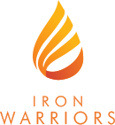

<div align="center">



### Rekordziści Polski w jeździe na kropelkę benzyny

[](https://nextjs.org/)
[](https://react.dev/)
[](https://www.typescriptlang.org/)
[](https://tailwindcss.com/)
[](https://www.postgresql.org/)
[](https://orm.drizzle.team/)
[](https://www.better-auth.com/)
[](https://www.docker.com/)
[](LICENSE)

**Iron Warriors** to studenckie koło naukowe Politechniki Łódzkiej, które buduje superoszczędne bolidy Eco Arrow (Rekord Polski: 837 km/l benzyny i 2267 km/l w kategorii elektrycznej). To repozytorium zawiera nową stronę zespołu razem z własnym panelem CMS, w którym da się edytować całą treść witryny.

[Strona zespołu](https://ironwarriors.p.lodz.pl) · [Instrukcja uruchomienia](SETUP.md) · [Utrzymanie](MAINTENANCE.md)

</div>

## Szybki start

Lokalne środowisko pełnoprawne: PostgreSQL w Dockerze, better-auth i panel CMS do edycji całej strony.

> 👉 **Kompletna instrukcja uruchomienia na nowym komputerze: [SETUP.md](SETUP.md).** Wdrożenie i utrzymanie na serwerze (Docker, HTTPS, kopie zapasowe, aktualizacje): [MAINTENANCE.md](MAINTENANCE.md).

Krótka wersja (zakładając, że kontener `iw-postgres` już istnieje):

| Krok | Komenda / działanie |
|---|---|
| **1. Docker** | Upewnij się, że **Docker Desktop jest uruchomiony** |
| **2. Baza** | `corepack pnpm db:up` (port `55432`) |
| **3. Schemat i dane** | `corepack pnpm db:migrate && corepack pnpm db:seed` |
| **4. Aplikacja** | `corepack pnpm dev` → http://localhost:3000 |

> **Błąd `ECONNREFUSED ...:55432`** oznacza, że Docker Desktop nie działa albo kontener bazy zniknął.

---

## Uruchomienie całego środowiska w Dockerze

```bash
docker compose up --build
```

| Usługa | Adres |
|---|---|
| **Aplikacja** | http://localhost:3000 |
| **PostgreSQL** | port `55432` |

Docker Compose sam utworzy bazę, zastosuje migracje i dane startowe. Kolejne restarty nie nadpisują treści dodanej w panelu (`scripts/seed-if-empty.mjs`).

Zatrzymanie i usunięcie kontenerów:

```bash
docker compose down        # zachowuje wolumeny z bazą i uploadami
```

> **Uwaga:** nie używaj `docker compose down -v`, bo usuwa całą treść i zdjęcia.

---

## Panel administratora

| | |
|---|---|
| **Adres** | http://localhost:3000/iw-panel-7k2q/login |
| **Pierwsze konto** | `ADMIN_EMAIL`, `ADMIN_PASSWORD` (min. 12 znaków) i opcjonalnie `ADMIN_NAME` z pliku `.env` obok `docker-compose.yml` (nie `.env.local`) |
| **Bootstrap** | Idempotentny, więc po pierwszym uruchomieniu możesz usunąć `ADMIN_PASSWORD` z `.env`. Konto zostanie w bazie |
| **Rejestracja** | Zablokowana w przeglądarce |
| **Kolejne konta** | Najwygodniej w panelu: **Administracja → Konta i role**. Role, reset haseł i 2FA opisuje [KONTA-I-ROLE.md](KONTA-I-ROLE.md) |

CLI pozostaje do bootstrapu i automatyzacji:

```bash
docker compose exec -T app node scripts/create-account.mjs \
  --email jan@example.com --name "Jan Kowalski" --role editor --password-stdin
```

---

## Panel CMS: edycja całej strony

| Sekcja | Co robi |
|---|---|
| **Treść strony** | 17 obszarów (strona główna, nagłówek, stopka, CTA, bolidy, rekrutacja, kontakt, zostań partnerem, ustawienia itd.). Wybierasz obszar, potem wpis, i dostajesz formularz z etykietami i jednym przyciskiem „Zapisz treść”. Każdy wpis można przywrócić do wartości domyślnych, a w obszarach wielowpisowych jest „Dodaj i edytuj”. |
| **Nawigacja (navbar)** | Etykiety, linki, rodzic, kolejność i przycisk CTA. Zmiany pojawiają się na wszystkich stronach. |
| **Osoby** | Biblioteka 121 kart (imię, zdjęcie, portret). Zmiana osoby aktualizuje ją we wszystkich składach, bez edytowania każdego roku osobno. |
| **Konta i role** | Administrator dodaje i usuwa konta, zmienia role oraz resetuje hasła i 2FA. Zasady i zabezpieczenia: [KONTA-I-ROLE.md](KONTA-I-ROLE.md). |

### Elementy powtarzalne

Są zdefiniowane raz, a pozostałe miejsca tylko się do nich odwołują:

| Źródło | Gdzie jest używane |
|---|---|
| **Osoby** | `Zespoły – sekcje` (64 sekcje, 221 odwołań) i `Zespoły – roczniki` |
| **Katalog partnerów** (42 karty) | `Partnerzy – grupy` i `Partnerzy – roczniki` |
| **Ustawienia strony** | Link do oferty sponsorskiej (`sponsorPdf`) na `Kontakt` i `Zostań partnerem` |

> **Treść z fallbackiem.** Domyślne treści żyją w `lib/content-registry.ts`. Baza nie musi być seedowana treścią: brak wpisu w `site_content` oznacza automatyczny fallback do wersji 1:1 z oryginalnej strony. Zmiana zapisuje tylko nadpisany wpis.

---

## Strony publiczne

Nawigacja i treści odwzorowują `https://ironwarriors.p.lodz.pl`:

| Adres | Co zawiera |
|---|---|
| `/` | Strona główna: hero, „O nas”, „O nas w liczbach” / „Nasze Rekordy”, „Nasze bolidy”, CTA |
| `/bolidy`, `/bolidy/[slug]` | 4 bolidy z pełnymi specyfikacjami i galeriami |
| `/zespol-2025-2026` … `/zespol-2022-2023` | Składy zespołów z czterech sezonów |
| `/projekty`, `/projekty-mnisw`, `/projekty-rada-kol`, `/projekty-fundacja-pl`, `/projekty-miasto-lodz` | 25 projektów w 4 kategoriach |
| `/partnerzy-2026` … `/partnerzy-2023` | Logo partnerów wg roku |
| `/kontakt` | Dane kontaktowe, zdjęcie i tekst oferty sponsorskiej, edytowalne w „Treść strony → Kontakt” |
| `/dolacz-do-nas`, `/zostan-partnerem`, `/blog` | Rekrutacja, oferta dla partnerów, blog |

> **Adresy URL są identyczne jak w źródle.** Adresy z myślnikiem (`zespol-*`, `partnerzy-*`, `projekty-*`) to maski z `next.config.mjs` prowadzące do tras `zespol/[year]`, `partnerzy/[year]` i `projekty/[slug]`.

Zdjęcia pobrane z oryginalnej strony znajdują się w `public/images/`. Źródło nie publikuje wpisów bloga, ale `/blog` i dwa przykładowe wpisy zostały zachowane, aby CMS był w pełni funkcjonalny.

---

## Uploady

| Tryb | Gdzie trafiają pliki | Jak są serwowane |
|---|---|---|
| **Bez `BLOB_READ_WRITE_TOKEN`** (lokalnie) | `public/uploads/` | Dynamicznie pod `/api/uploads/...` |
| **Z tokenem Vercel Blob** (produkcja) | Prywatny bucket | Przez `/api/media` |

---

## Kontrola jakości

```bash
corepack pnpm typecheck
corepack pnpm lint
corepack pnpm test
corepack pnpm build
```

> **`build` wymaga działającej bazy**, ponieważ strony publiczne są prerenderowane i odświeżane przez `revalidatePath()` po zmianach w CMS.

---

## Dokumentacja

| Dokument | Zawartość |
|---|---|
| [SETUP.md](SETUP.md) | Kompletna instrukcja uruchomienia na nowym komputerze |
| [MAINTENANCE.md](MAINTENANCE.md) | Wdrożenie i utrzymanie na serwerze: Docker, HTTPS, kopie zapasowe, aktualizacje |
| [KONTA-I-ROLE.md](KONTA-I-ROLE.md) | Konta, role, reset haseł i 2FA w panelu |

---

<div align="center">

Zbudowane przez **Iron Warriors**, Politechnika Łódzka

[Strona zespołu](https://ironwarriors.p.lodz.pl) · Licencja [GPL-2.0-or-later](LICENSE)

</div>
